# SkillSeat

SkillSeat is the working title for a Code Institute Milestone Project 4 full-stack Django application.

## Project overview

SkillSeat is a Django workshop discovery and booking application. Phase 3 implements the committed core features, with real database, permission, concurrency and browser evidence. Phase 3 is complete with a genuine hosted Stripe sandbox payment and signed webhook verification. Phase 4 release preparation is underway; Heroku deployment is blocked by declined paid provisioning; final assessment readiness remains unverified.

## Purpose and intended audience

SkillSeat helps people discover practical workshops, manage their participation, and access private learning resources after verified paid booking.

The intended audiences are:

- public visitors discovering workshops;
- registered attendees booking workshops and managing their participation; and
- workshop owners and administrators managing listings and related workflows.

## Current development status

- Phases 1–3 are complete within their recorded development scope, including a genuine hosted Stripe sandbox payment and signed fulfillment. Phase 4 is in progress.
- **SkillSeat live Heroku URL: not yet available.** The existing Heroku account and ByteBoard ownership are verified. A separate empty app record, `skillseat-akkhoujja`, exists in Europe on heroku-24/Cedar, with **zero dynos and zero add-ons**. The user declined paid provisioning on 19 October; no billable SkillSeat resource was created and ByteBoard is unchanged.
- Python **3.13.16** and Django **5.2.18** are preserved. The original 110 tests passed before release work. The current **127-test suite passed on real disposable PostgreSQL 17.11 and SQLite**, including seven independent-connection races.
- Heroku configuration, hash-locked production installation, private database storage, health checks, safe error pages and shared authentication throttling are implemented. Real hosted deployment, scheduler execution and hosted restart checks remain pending.
- The authoritative learner-specific MS4 rubric/submission instructions are unavailable. The requirements-based audit below does not claim an institutional grade.

## Planned product scope

The following committed core scope now has implementation and automated evidence. The payment story also has genuine hosted sandbox payment, signed webhook, protected download and replay evidence:

- public workshop discovery and workshop detail pages;
- registration, login, logout, and account management;
- workshop listing management for authorised owners and administrators;
- booking, cancellation, and server-enforced capacity controls;
- attendee reviews;
- Stripe test-mode payments with a verified payment state; and
- access-controlled workshop resources for paid attendees.

No optional enhancements are committed at this stage. They will only be considered after the core scope, tests, accessibility evidence, and documentation are complete.

## User stories and acceptance criteria

These stories define the agreed acceptance requirements. The [acceptance evidence map](docs/phase-3-architecture.md#acceptance-evidence-map) connects each story to implementation and real tests, and records the completed genuine sandbox exercise.

### Committed core stories

**P0 — Anonymous visitor discovers a workshop**

As a public visitor, I want to browse workshops and open their details so that I can decide whether a workshop is relevant to me.

Acceptance criteria:

- workshop discovery is available without authentication;
- a workshop detail view presents the information needed to evaluate it; and
- an unavailable or invalid workshop does not expose unrelated records or internal errors.

**P0 — Visitor creates and uses an attendee account**

As a visitor, I want to register, sign in, sign out, and manage my account so that my participation is associated with my own identity.

Acceptance criteria:

- registration validates required input and does not reveal sensitive account information;
- login and logout provide clear success or failure states; and
- account actions cannot be used to access another attendee's account.

**P0 — Attendee books within capacity**

As an authenticated attendee, I want to book an available workshop so that I can reserve a place.

Acceptance criteria:

- only authenticated attendees can create bookings;
- a booking cannot increase attendance beyond the workshop capacity;
- concurrent booking attempts must respect the final available seat without overselling, with automated concurrency verification required during implementation;
- repeated booking attempts do not create duplicate active bookings for the same attendee and workshop; and
- the attendee can see the resulting booking state.

**P0 — Attendee cancels their booking**

As an authenticated attendee, I want to cancel my own booking so that my place can become available to someone else.

Acceptance criteria:

- an attendee can cancel only their own eligible booking;
- cancellation releases the reserved capacity according to the implemented booking rules; and
- an attendee cannot cancel or alter another attendee's booking.

**P0 — Attendee pays with verified test-mode payment**

As an attendee, I want to pay through Stripe test mode so that a paid booking has a trustworthy payment state.

Acceptance criteria:

- payment uses Stripe test credentials and never exposes secret credentials in client-side code or Git history;
- a booking is not treated as paid solely because a client reports success;
- the server records payment as verified only after the agreed Stripe confirmation flow;
- failed, cancelled, or expired payment attempts cannot permanently consume workshop capacity;
- the booking hold, payment expiration, and capacity-release policy is explicitly documented and tested during implementation;
- payment confirmation is verified server-side; and
- repeated provider notifications are handled idempotently and cannot process the same payment twice.

**P1 — Paid attendee accesses workshop resources**

As an attendee with a verified paid booking, I want to access the resources for that workshop so that I can prepare for or continue my training.

Acceptance criteria:

- access is granted only for the relevant workshop and verified paid booking;
- anonymous users, unpaid attendees, and attendees without the relevant booking are denied; and
- owners and administrators can manage resource access without exposing unrelated private resources.

**P1 — Attendee submits a review**

As an eligible attendee, I want to submit a review for a workshop I attended so that I can record useful feedback.

Acceptance criteria:

- a confirmed booking alone does not establish review eligibility before the workshop has taken place;
- review eligibility follows a documented attendance or completion policy and is enforced and tested server-side;
- an eligible authenticated attendee can submit one review for that workshop;
- an attendee can manage only their own review for that workshop; and
- review content is validated and displayed according to the moderation and visibility rules defined during implementation.

**P0 — Workshop owner manages their listings**

As a workshop owner, I want to create and manage my own workshop listings so that the public information remains accurate.

Acceptance criteria:

- an authorised owner can create, edit, publish, unpublish, or otherwise manage only their own listings;
- submitted ownership is assigned or verified server-side; and
- one owner cannot read or modify another owner's protected management data.

**P1 — Owner or administrator manages related workflows**

As an authorised workshop owner or administrator, I want to manage capacity, bookings, and workshop resources within my authority so that the platform remains operational.

Acceptance criteria:

- owners are restricted to workshops they own;
- administrators can perform the explicitly defined administrative actions across the platform;
- capacity changes cannot create an invalid overbooked state; and
- every protected action enforces authorization on the server, not only in the interface.

**P0 — Platform protects role and data boundaries**

As a platform maintainer, I want permission checks and payment state checks to be enforced server-side so that private data and paid resources are not disclosed.

Acceptance criteria:

- anonymous users cannot access authenticated, owner, administrator, or paid-resource actions;
- attendees cannot perform owner or administrator actions;
- owners cannot cross their ownership boundary;
- object-level authorization is covered by tests; and
- invalid identifiers, forged form data, replayed requests, and altered client-side payment states fail safely.

## Development phases

Development will remain within four phases. Implementation will follow strict Red → Green → Refactor TDD, with many small, meaningful commits that keep code, tests, and documentation aligned.

### Phase 1: Repository Foundation

Objective: establish a safe, documented, reviewable project baseline.

Deliverables: repository protections, the product direction, prioritised user stories, four-phase plan, and the documentation roadmap.

Completion criteria: only safe project foundations are committed; no secrets or local artefacts are tracked; the README distinguishes planned scope from implemented evidence; and independent review can verify the baseline.

### Phase 2: Django Foundation

Objective: create the smallest working Django foundation needed for tested development.

Deliverables: project configuration, dependency definitions, environment configuration guidance, initial application structure, initial data model decisions, and the first Red → Green → Refactor test slices.

Completion criteria: the foundation runs locally, configuration is documented, initial security boundaries are tested, and no feature is described as complete without passing evidence.

Status: verified with 42 passing tests, applied initial migrations, no migration drift, production configuration checks, a real-server smoke check, and a successful Windows CI run. The development history retains separate failing-test and passing-implementation commits; see [the ordered evidence record](docs/phase-2-evidence.md#commit-evidence).

### Phase 3: Core SkillSeat Features

Objective: implement the committed discovery, account, workshop management, booking, capacity, review, payment, and resource-access scope.

Deliverables: incremental models, views, templates, forms, permissions, payment integration, resources, tests, design evidence, and documentation updates.

Completion criteria: each committed user story has passing relevant tests, including permission, capacity, and payment-state cases; responsive and accessible behaviour has evidence; and documentation matches the implementation.

Status: core implementation and automated/browser verification are documented in [Phase 3 evidence](docs/phase-3-evidence.md). Genuine hosted sandbox payment, signed delivery, paid resource access and replay verification now pass. Phase 4 release/deployment work is now in progress; its independent checks and external blockers are recorded below.

### Phase 4: Release and Evidence

Objective: prepare, verify, and honestly document a releasable application.

Deliverables: production configuration, deployment evidence, security review, Git-history secret scanning, browser and accessibility checks, final screenshots, known limitations, credits, and reflection.

Completion criteria: release checks are reproducible, deployment claims are supported by recorded evidence, unresolved limitations are explicit, and the final README makes no unsupported claims.

## Documentation roadmap

Documentation will evolve with the real implementation. Planned documentation includes:

- wireframes and design rationale, with planned-versus-final comparisons for major journeys;
- data model entities, relationships, constraints, migrations, and ownership rules;
- routes, permissions, protected resources, and user journeys;
- technology choices, dependency rationale, and version records;
- local setup, environment configuration, and safe test credentials guidance;
- unit, integration, permission, payment, and browser testing evidence;
- responsive design decisions and accessibility evidence across relevant views;
- deployment steps, production configuration, and verification results;
- security review, including Git-history secret scanning and authorization boundaries; and
- known limitations, credits, and an honest reflection on decisions, challenges, and learning.

## Design and wireframes

The original planning artefact was committed on **17 October 2026 before implementation**. It contains text wireframes, rather than image files. The SVGs below were rendered from that unchanged text during Phase 4 on **19 October** using `scripts/render_planning.py`; the rendering dates are printed on the images. They are not retroactively invented historical image wireframes. **No separate original mobile image wireframes existed.** Mobile intent was documented as wrapping navigation, stacked cards/detail columns, labelled forms and touch-friendly controls.

| Journey | Original planning | Authentic implemented evidence | Outcome |
| --- | --- | --- | --- |
| Home/discovery/detail | Original desktop text, rendered below | Desktop home, mobile discovery, tablet detail | Clear discovery entry, cards and a booking sidebar; stacks on narrow screens |
| Account/booking/payment | Original journey text, rendered below | Registration, confirmed booking, pending/payment feedback | One account dashboard and explicit server payment state |
| Owner management | Original studio text, rendered below | Owner editing/roster/resource screen | Separate owner boundary, mobile-friendly sequential sections |
| Mobile | Responsive intent in the original text; no standalone image wireframe | Actual mobile home, discovery and registration | Navigation wraps; forms and cards remain within the viewport |

### Home, discovery and workshop details

**Planning evidence → implementation → outcome**

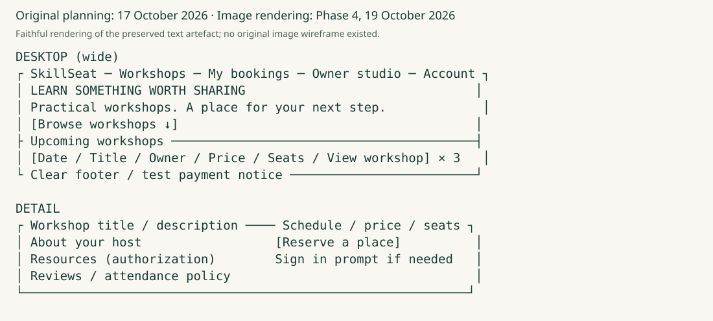

The following are authentic **local Django application** screenshots captured during Phase 3 verification, not Heroku screenshots. Hosted replacements cannot be claimed before deployment.

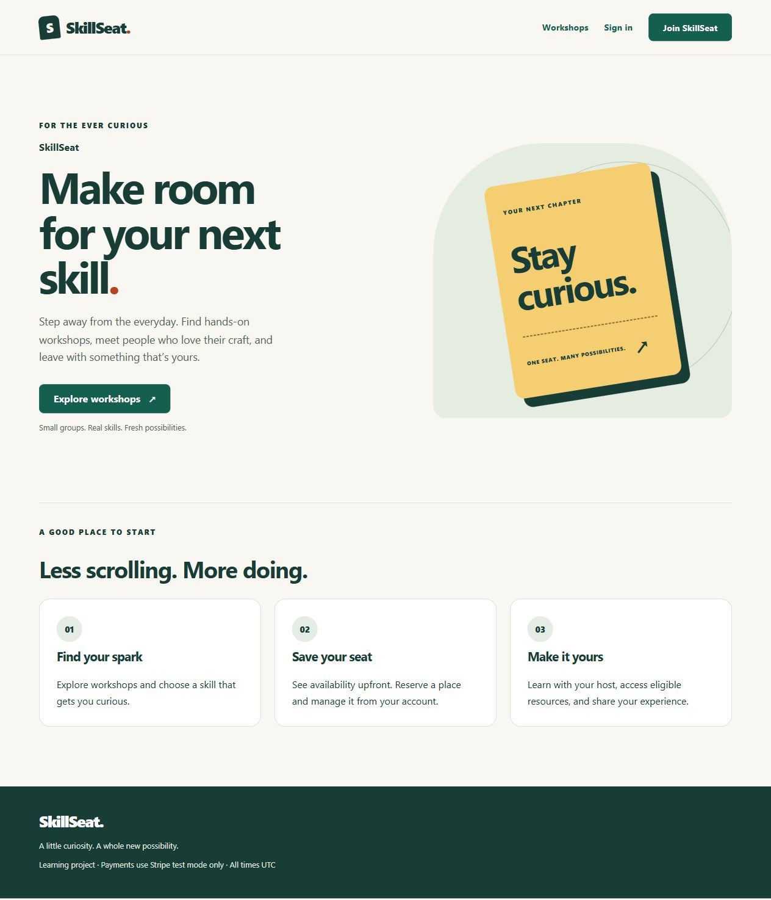

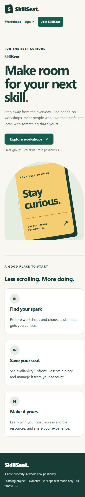

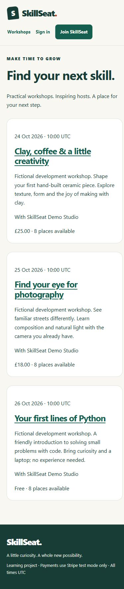

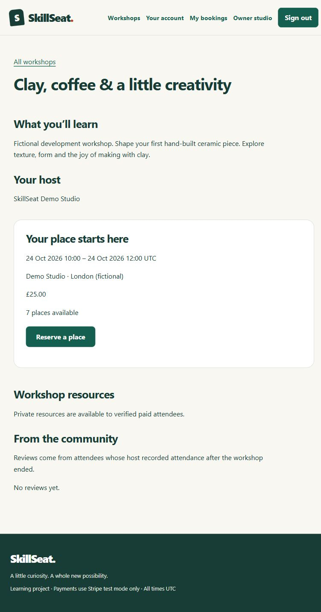

The final page retains the planned hierarchy but adds an original CSS ticket illustration and a three-step introduction. Workshop cards show fictional host, UTC schedule, GBP price and seats. Discovery now excludes started workshops; their published detail pages retain reviews without advertising bookable seats. Existing attendees are directed to their booking management rather than another reservation attempt.

### Accounts, bookings and payment states

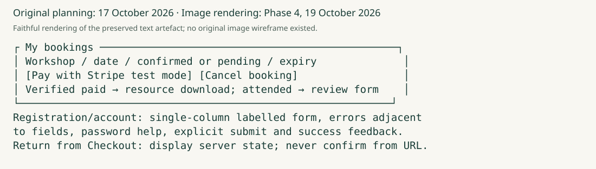

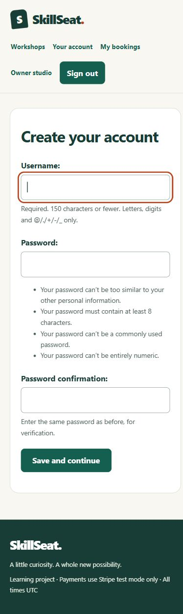

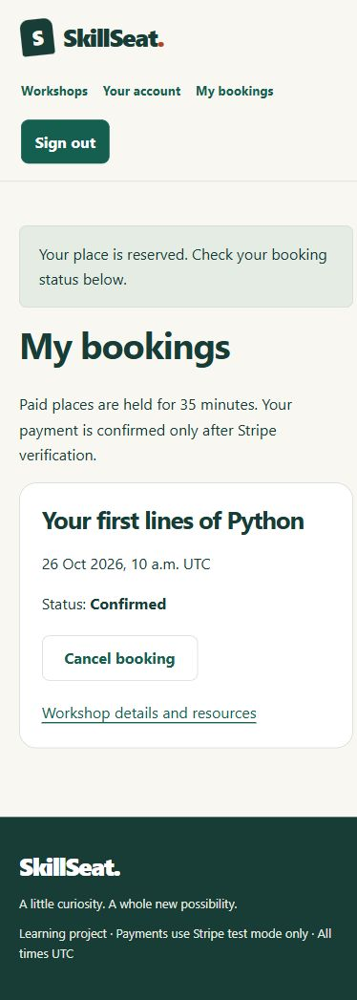

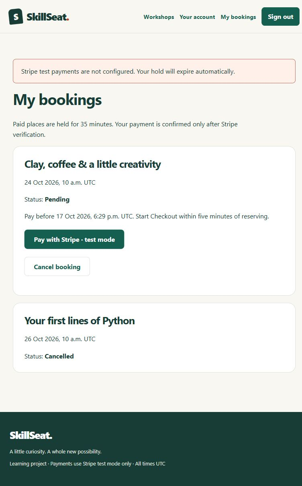

The final flow uses Django forms, own-account controls and clear state feedback. Browser review exposed duplicated labels and invalid help-text structure; unique resource IDs and block help with aria-describedby corrected them. The payment-error screenshot is a historical configuration-denial checkpoint, not a successful payment screenshot. Phase 3 subsequently completed the genuine hosted sandbox exercise. Checkout initiation guidance is now four minutes after reservation to retain Stripe's minimum session lifetime plus a safety margin.

### Owner studio and protected resources

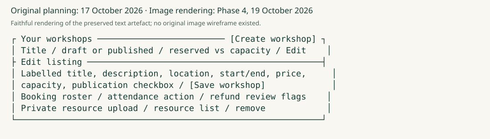

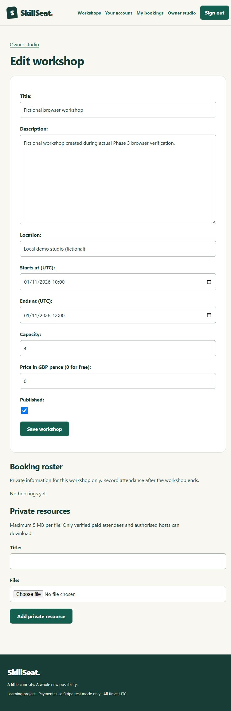

The sequential edit → roster → resource layout replaces a dense table so controls remain usable on mobile. A trusted administrator grants the owner permission; form fields cannot assign ownership. Resource downloads always pass object-level checks. Private bytes now persist in the separately configured production database rather than an ephemeral dyno directory.

Release-specific local login, account dashboard, private-resource and review screenshots follow below. No original planning image or hosted result is invented to fill an evidence gap. Supplementary provenance and detailed observations remain in the design evidence, while these actual assets are embedded here for the assessor.

### Release journey evidence — local application, 19 October 2026

The following are authentic captures from the running local Django application. The owner, attendee, completed workshop and review are explicitly fictional verification fixtures; no attendance or payment by a real person is asserted. The host recorded attendance through the studio, the attendee then submitted an eligible review, and an unpaid direct-file request returned 404. An authorised host downloaded the exact fictional handout bytes through the browser. These are separate from the earlier genuine Stripe sandbox payment record.

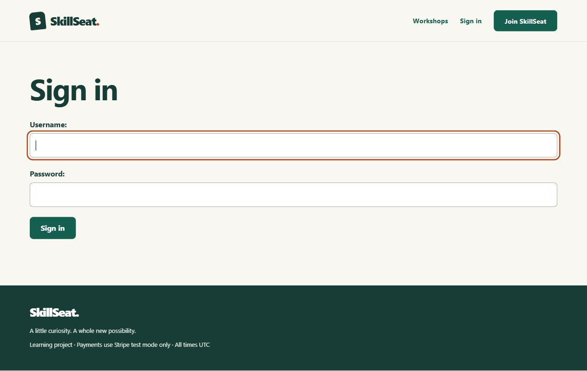
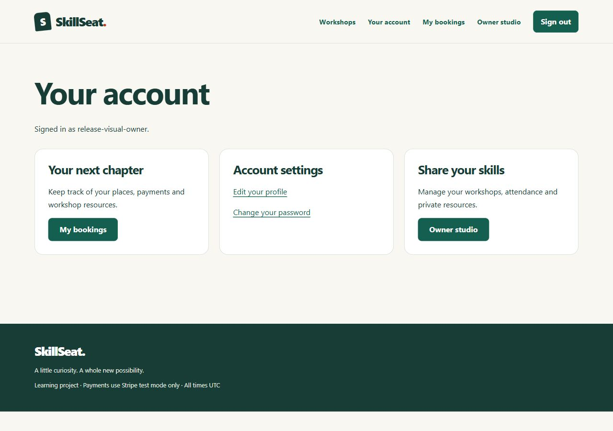
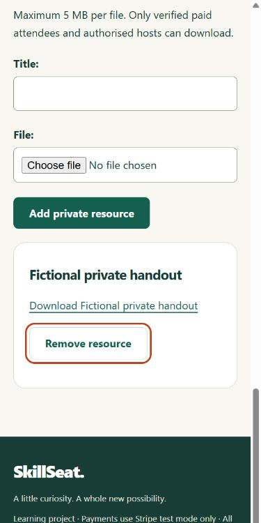
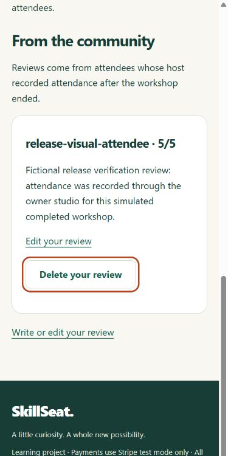
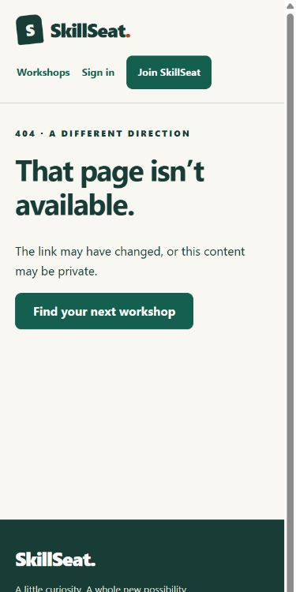

At 390px, owner and review pages had document width 375px and no horizontal overflow; keyboard focus is visible on the resource/review controls. The release journey also exposed a stale cancellation action on a completed workshop: the server already denied it, and a new Red/Green interface test now replaces that control with the cancellation deadline. On actual GitHub, all 11 original embedded images loaded at nonzero natural widths and all three Mermaid diagrams rendered; all 16 embedded images including the release captures were confirmed loaded in the actual GitHub render after pushing. No physical-device or screen-reader result is claimed.

## Features

- Public upcoming published-workshop cards and details with host, UTC schedule, location, price and current seats. Past details remain available for reviews, with booking closed.
- Registration, sign-in/out, own-profile editing and password changes using Django authentication and validation.
- Permission-provisioned owner studio: create/edit/publish/unpublish, safe capacity changes, booking roster, attendance and private resource upload/removal. Superusers can work across owners.
- Own booking history, free confirmation, paid pending holds, cancellation and executable expiry cleanup, with database-backed capacity and duplicate protections.
- Stripe test-only hosted Checkout, server price snapshots, signed event verification, durable replay protection and explicit late-payment refund review. Offline tests and a genuine £25 GBP hosted sandbox payment pass, including authenticated CLI forwarding, signed fulfillment, paid resource access and genuine-event replay protection. [Provider verification evidence](docs/phase-3-evidence.md#completed-manual-sandbox-payment--18-october-2026).
- Authorised private downloads for relevant verified-paid confirmed attendees; files have no public media URL.
- Reviews only after workshop completion and owner-recorded attendance, own editing/deletion and superuser visibility moderation.
- Shared responsive styling, accessible labels/help/errors, skip navigation, keyboard focus and clear server-state feedback.

## Data model

The established `accounts.User` remains a Django AbstractUser. All user relationships use AUTH_USER_MODEL. The diagram shows actual foreign-key relationships; PrivateResourceBlob and AuthThrottle are independent storage/operational tables.

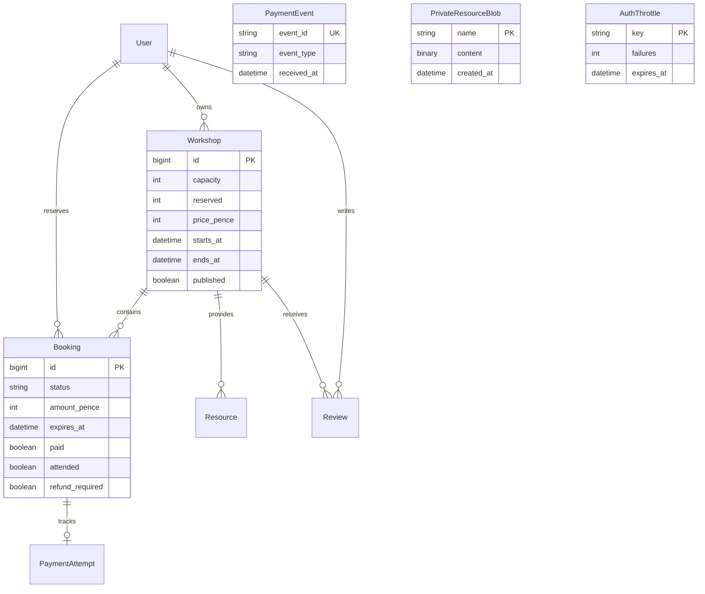

| Constraint/decision | Application guarantee |
| --- | --- |
| Workshop capacity >=1 and reserved <= capacity | Counters cannot describe an oversold workshop |
| Ends after starts; aware UTC dates | Ordered schedules; every interface labels UTC |
| Integer GBP pence, 0 or 50–99,999,999 | No floating-point payment amounts; free is explicit |
| Partial unique active attendee/workshop booking | At most one pending/confirmed booking; terminal history retained |
| Pending has expiry/positive amount; paid-price confirmation requires paid=true | Invalid stored combinations rejected |
| Unique Checkout Session and unique event receipt | Stored payment identity and durable webhook replay protection |
| Review unique per attendee/workshop; rating 1–5 | Database-backed review uniqueness/rating bounds |
| Protected financial/user relationships | Referenced owners/attendees and financial records are not silently deleted |

`Resource.file` is a private storage key, not a public URL or database foreign key to the blob table. Heroku policy selects database bytes (maximum 5 MB/file), while ordinary local development retains private filesystem storage. This avoids another paid storage provider, but consumes the application's database quota. Actual local PostgreSQL restart preserved the stored handout bytes. A Heroku restart has not yet been tested.

## Application architecture

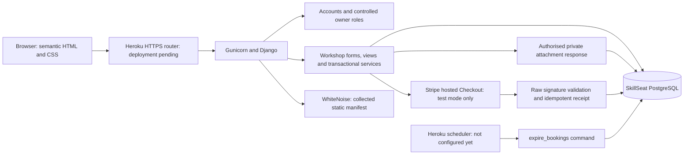

`config` owns environment/release policy; `core` owns the public interface, readiness and response headers; `accounts` owns user/account forms and database-shared abuse limits; `workshops` owns the domain, storage and payment services. Templates are server-rendered without a frontend framework or remote font dependency. The PostgreSQL diagram describes the prepared deployment design; it is not evidence of a completed Heroku release.

Heroku mode must be explicit and rejects missing PostgreSQL/HTTPS origin configuration. Only that mode trusts forwarded protocol, requires database TLS and selects persistent database storage. Local mode remains SQLite by default and distrusts proxy headers. `/health/` performs a read-only database probe and returns generic 200/503 JSON without exposing connection details.

## Routes

| Route | Access / operation |
| --- | --- |
| `/`, `/workshops/`, `/workshops/<id>/` | Public home/upcoming published discovery/detail |
| `/accounts/register/`, `/accounts/login/` | Validated attendee registration/authentication; abuse limited |
| `/accounts/`, `/accounts/edit/`, `/accounts/password/` | Authenticated user's own identity/profile/password |
| `/accounts/logout/` | CSRF-protected POST only |
| `/workshops/<id>/book/` | Authenticated POST; server price and capacity |
| `/workshops/bookings/` | Own history and server payment state |
| `/workshops/bookings/<id>/cancel/`, `.../checkout/` | Own booking, POST only |
| `/workshops/studio/`, `.../new/`, `.../<id>/` | Granted owner permission; own rows, superusers across rows |
| `/workshops/studio/<id>/resources/` | Authorised upload, POST only |
| `/workshops/studio/bookings/<id>/attend/` | Authorised owner records attendance after end, POST only |
| `/workshops/resources/<id>/` | Relevant verified-paid confirmed attendee or authorised owner/superuser |
| `/workshops/resources/<id>/delete/` | Authorised owner, POST only |
| `/workshops/<id>/review/`, `/workshops/reviews/<id>/delete/` | Eligible own review; deletion POST only |
| `/workshops/payments/webhook/` | POST, real Stripe signature/timestamp; sole CSRF exemption |
| `/admin/` | Django staff boundary; financial audit read-only, review moderation superuser-only |
| `/health/` | Public generic read-only readiness probe; no-store |

## Technology stack

| Technology | Actual version/use |
| --- | --- |
| Python / Django | 3.13.16 / 5.2.18, unchanged approved runtime |
| Stripe SDK | 16.0.0, explicitly pinned API 2026-09-30.endive, test mode only |
| Gunicorn / WhiteNoise | 26.2.0 / 6.12.0, prepared production WSGI/static serving |
| dj-database-url / Psycopg | 3.1.2 / 3.3.6 with binary driver, PostgreSQL selection |
| PostgreSQL | Actual disposable local 17.11 tested; Heroku version not yet provisioned |
| SQLite | Preserved local default and regression backend |
| Ruff | 0.17.1, lint/format checks |
| HTML/CSS | Django templates and original responsive CSS; no application JavaScript |

`requirements.in` contains deliberate direct pins. `requirements.lock` freezes transitive packages with hashes. Heroku's standard `requirements.txt` delegates to the hash lock with --require-hashes, so default platform installs are reproducible. CI installs the same lock. Optional ignored local CLI/audit tools are not application dependencies.

## Local setup

### Windows runtime and virtual environment

Use Python **3.13.16** and Django **5.2.18**. The verified Windows x64 fallback is the official [Python NuGet distribution](https://docs.python.org/3.13/using/windows.html#the-nuget-org-packages). It extracts into a dedicated per-user directory without an installer, administrator privileges, PATH changes, or changes to existing Python installations.

From PowerShell in this repository, with uv installed:

```powershell
.\scripts\Install-Python.ps1
$python = Join-Path $env:LOCALAPPDATA 'SkillSeat\runtimes\python-3.13.16\package\tools\python.exe'
uv venv --python $python .venv
uv pip install --python .venv/Scripts/python.exe --require-hashes -r requirements.lock -r requirements-dev.lock
.venv/Scripts/python.exe -c "import sys, django; print(sys.version); print(sys.executable); print(django.get_version())"
uv pip check --python .venv/Scripts/python.exe
```

The script validates package identity and SHA-512 against official NuGet catalog metadata before extracting or executing it. Keep the extracted runtime: the virtual environment depends on it. NuGet runtimes are replaced with a newly verified version rather than updated in place. Do not use the embeddable distribution for this setup.

The standard-library alternative has also been verified in a separate clean environment: replace the uv environment/install commands with `& $python -m venv .venv`, then `.venv/Scripts/python.exe -m pip install --require-hashes -r requirements.lock -r requirements-dev.lock` and `.venv/Scripts/python.exe -m pip check`. Choose one setup route for a new environment; do not recreate a working environment unnecessarily. Activation is optional because every command names its interpreter explicitly.

Configuration validation is implemented in `config/environment.py`. Production is the default; development must be selected explicitly. A strong `DJANGO_SECRET_KEY` is required in both modes. Production rejects debug mode and requires explicit allowed hosts. Missing, placeholder, or invalid values fail before the application starts. `.env.example` documents placeholders; it is not automatically loaded.

Configure the current PowerShell session, then run checks or the local server:

```powershell
$env:DJANGO_ENV = 'development'
$env:DJANGO_SECRET_KEY = .venv/Scripts/python.exe -c "import secrets; print(secrets.token_urlsafe(64))"
.venv/Scripts/python.exe manage.py migrate --noinput
.venv/Scripts/python.exe manage.py check
.venv/Scripts/python.exe manage.py test -v 2
.venv/Scripts/python.exe manage.py runserver 127.0.0.1:8000
```

The generated development key is ephemeral; use a stable private key in your local environment when preserving sessions. The database is local SQLite at ignored `db.sqlite3`. The custom user model is already configured; initialise the database with `.venv/Scripts/python.exe manage.py migrate`. Create a local administrator only when needed using `manage.py createsuperuser`; no credentials are shipped. Database migration checks are recorded in the evidence log when executed.

uv 0.12.17 predates this Python build and cannot download it from its bundled list. Passing the exact NuGet executable avoids that limitation. The full installer previously exited with access denied inside the restricted sandbox. If a managed environment denies network, cache, external-directory, or loopback-server access, use its approved permission mechanism; do not disable security controls. In a normal user PowerShell session, this route needs no Windows installer.

### Environment variables

| Variable | Development | Production |
| --- | --- | --- |
| `DJANGO_ENV` | Set explicitly to `development` | Defaults to `production` |
| `DJANGO_SECRET_KEY` | Required, generated private value | Required, stable private value |
| `DJANGO_DEBUG` | Defaults to `true`; accepts `true`, `false`, `1`, `0` | Defaults to `false`; enabling it is rejected |
| `DJANGO_ALLOWED_HOSTS` | Defaults to `localhost,127.0.0.1,[::1]` | Required comma-separated explicit hostnames |
| `STRIPE_TEST_KEY` | Private test restricted key; blank disables Checkout | Test mode only; live key prefixes refused |
| `STRIPE_WEBHOOK_SECRET` | Private listener signing secret | Private endpoint signing secret; no live events accepted |
| `PAYMENT_ORIGIN` | Defaults to `http://localhost:8000` | Explicit HTTPS origin for test return URLs |
| `SKILLSEAT_FILE_TEST_DB` | `1` selects ignored file-backed test DB for race verification | Test-only; leave unset for normal operation |

For Heroku set `DJANGO_DEPLOYMENT=heroku`, an attached PostgreSQL `DATABASE_URL`, and `DJANGO_CSRF_TRUSTED_ORIGINS=https://<actual-skillseat-host>`. This explicit mode forces PostgreSQL SSL, trusts the Heroku HTTPS router, and selects database-backed private bytes. Missing production prerequisites fail startup; local development keeps its SQLite/filesystem defaults.

Keys must contain at least 50 characters and five distinct characters; known placeholder prefixes are rejected. Generate a random key rather than merely satisfying those checks. Host values must not contain a URL scheme, port, wildcard, or empty entry. Unknown environment names fail instead of silently choosing a mode. There is no email delivery/verification service. `DATABASE_URL` selects PostgreSQL; proxy trust is enabled only by the explicit Heroku production policy described below. Stripe settings are environment-managed and never printed by application pages.

### Phase 3 local operation

After migrations, `manage.py seed_demo` creates three explicitly fictional workshops with a passwordless demo host (development only, idempotent). It does not create customers, payments or an administrator. Register your own attendee normally. A trusted administrator grants `workshops.add_workshop` through Django admin to provision an approved owner; registration never assigns it. Superusers manage all workshops through the studio and moderate reviews in admin.

Run `manage.py expire_bookings` to release unpaid 35-minute holds. Discovery/reservation/dashboard requests also perform cleanup. No background scheduler is assumed. Private uploads are stored under ignored `private-resources/`, with a 5 MB form limit and authorised attachment responses. Do not expose this folder through a web server. [Stripe setup and policies](docs/phase-3-architecture.md#stripe-test-mode-setup) explain hosted Checkout, signed local forwarding, pending/late events and manual test-refund review.

`requirements.in` retains the approved Django pin; `requirements.txt` is the hash-enforcing Heroku entrypoint. `requirements.lock` additionally freezes its transitive dependencies with hashes and a Windows marker for `tzdata`. `requirements-dev.txt`/`.lock` add only Ruff 0.17.1 for linting and formatting. Install from the lock files for reproducibility. When deliberately updating dependencies, regenerate with `uv pip compile requirements.in --universal --generate-hashes --output-file requirements.lock` and the equivalent command for `requirements-dev.txt`; review and test the resulting diff. Do not change the approved runtime pins incidentally.

## Testing

The original Phase 2 foundation passed **42 tests**: 12 environment contracts, nine Django wiring/database checks, 12 authentication/model boundaries, and nine startup/security checks. All are retained within the current **127 passing tests**, independently executed on SQLite and real PostgreSQL 17.11. Real Red/Green runs and the subsequent formatting refactor are recorded in [the evidence log](docs/phase-2-evidence.md). Tests use an isolated in-memory database and real password hashing. Production startup is also exercised in fresh subprocesses.

With development environment variables set as above:

```powershell
.venv/Scripts/ruff.exe check .
.venv/Scripts/ruff.exe format --check .
uv pip check --python .venv/Scripts/python.exe
.venv/Scripts/python.exe manage.py check
.venv/Scripts/python.exe manage.py test -v 2
.venv/Scripts/python.exe manage.py makemigrations --check --dry-run
.venv/Scripts/python.exe manage.py migrate --noinput
.venv/Scripts/python.exe manage.py migrate --check
.venv/Scripts/python.exe scripts/smoke_server.py
git diff --check
```

The smoke script starts the real development server on a temporary loopback port, verifies HTTP 200 and the SkillSeat page, then stops its child process. The full test suite includes the original foundation cases plus accounts, discovery, owners, bookings, payment signatures/states, resources, reviews, interface and real connection races. [Phase 3 evidence](docs/phase-3-evidence.md) records actual counts, migration results and command output summaries. For a separate file-backed race run, set `SKILLSEAT_FILE_TEST_DB=1`, run `manage.py test tests.test_concurrency -v 2 --noinput`, then remove that environment variable. Tests recreate only the ignored test database, not db.sqlite3.

Check production configuration in a separate shell (the example host is check-only, not a deployed site):

```powershell
$env:DJANGO_ENV = 'production'
$env:DJANGO_DEBUG = 'false'
$env:DJANGO_ALLOWED_HOSTS = 'skillseat.example.com'
$env:DJANGO_SECRET_KEY = .venv/Scripts/python.exe -c "import secrets; print(secrets.token_urlsafe(64))"
.venv/Scripts/python.exe manage.py check --deploy --fail-level WARNING
```

This configuration check does not verify a real TLS endpoint, proxy, production database or hosting platform. Browser, accessibility, capacity, ownership and simulated payment evidence are recorded separately. The genuine hosted Stripe sandbox payment, signed delivery and replay results are recorded in [Phase 3 evidence](docs/phase-3-evidence.md#completed-manual-sandbox-payment--18-october-2026).

### Continuous integration

`.github/workflows/foundation.yml` runs on pushes and pull requests to `main`, and supports manual runs. A Windows runner verifies the official NuGet runtime, creates a fresh environment, installs hash-locked dependencies, asserts exact versions and interpreter location, checks dependency integrity, runs lint/format/system/tests/migrations/production checks, and smoke-tests the server. The checkout action is pinned to an immutable official release commit, permissions are read-only, and no repository secret is required. A random check-only key is generated per run.

[Phase 3 Windows CI run 39159120497](https://github.com/AbdulkadirKhoujja/codeinstitute-milestone-4-project/actions/runs/39159120497) completed successfully on `1d8154bef35d36e29164d1f59b7341fa42a586d4`, including the 110-test suite and separate file-backed concurrency run. The post-payment local run again passed **110 tests plus seven separate concurrency tests**. Completion evidence CI [39164323260](https://github.com/AbdulkadirKhoujja/codeinstitute-milestone-4-project/actions/runs/39164323260) also passed on `2aff9d2932c1ca8d0febab1108c3d38e0efb2d89`; all steps were inspected. These are historical Phase 3 successes. Phase 4 CI results and any pending final-code verification are recorded in the release table below. The earlier real lint failure remains documented; checks were not weakened. CI uses simulated Stripe fixtures and requires no payment secrets. This is verification, not deployment.

## Deployment

**SkillSeat has not yet been deployed.** The authenticated account owns ByteBoard. The separate empty `skillseat-akkhoujja` app record has ID `d49ce190-95dc-42a8-a0d8-34f6e38def7e` (Europe, heroku-24/Cedar). Its assigned hostname is `skillseat-akkhoujja-e88f42c60993.herokuapp.com`; this is **not a working application release**. Actual inventory confirms no dynos or add-ons. The user explicitly declined paid provisioning on 19 October. ByteBoard's separate public app remains the reference and was not modified or used as SkillSeat storage.

Prepared release configuration:

- Existing `.python-version` remains 3.13.16; Heroku officially supports Python 3.13, subject to its latest-patch policy at build time.
- `Procfile` release runs migrations; web runs Gunicorn with two workers/two threads, bounded timeout and stdout/stderr logs. No credentials are placed in process definitions.
- Heroku's normal pip entrypoint enforces requirements.lock hashes.
- `DJANGO_ENV=production`, `DJANGO_DEPLOYMENT=heroku`, strong DJANGO_SECRET_KEY, explicit hosts and HTTPS CSRF trusted origins are required. DATABASE_URL must reference SkillSeat's own PostgreSQL attachment; production SSL is required.
- WhiteNoise serves collected manifest static assets. Private files never use static/media URLs and persist as private database bytes.
- The idempotent `python manage.py expire_bookings` releases unpaid holds and prunes expired authentication counters. A real Heroku-compatible schedule is still required; no background scheduler is assumed.
- Stripe settings remain test-only. PAYMENT_ORIGIN must be the actual HTTPS SkillSeat origin. Hosted webhook endpoint configuration and its signing secret remain unverified.

If the user later explicitly approves the inspected costs, the deployment operator must use the existing separate empty app, reconfirm plan availability, attach its own PostgreSQL, privately set configuration, deploy verified main, inspect build/release/migrations, configure scheduled expiry, and execute the full hosted/restart checklist. Do not reuse ByteBoard's application, database or secrets. The actual account catalog offers Basic at USD 7/month, Essential-0 at USD 5/month and Scheduler at USD 0/month plus billed job runtime. The proposed USD 12/month base and USD 20/month total limit were **declined**. No billable provisioning is authorised. Private database bytes require no storage add-on. Heroku prorates dyno runtime to the second (Basic approximately USD 0.01/hour); release/verification runtime must also stay within any future approved limit.

Hosted verification must include HTTPS discovery, accounts, owner CRUD, booking/cancellation/capacity/expiry, actual PostgreSQL persistence, test-only payments/signatures/replay, protected resources, reviews, static assets, responsive/security behaviour and restart persistence. The assessment-readiness status remains Not Verified until this evidence exists.

## Security

Environment secrets and local data are ignored. Production retains HTTPS redirects, secure HTTP-only/SameSite cookies, HSTS, frame denial, nosniff and a restrictive application CSP. Only explicit Heroku mode trusts the router protocol. CSRF trusted origins must be explicit HTTPS origins without credentials, wildcards or paths.

Object-level checks scope owners, accounts, bookings, reviews and resources on the server. Forms exclude privileged ownership/payment/visibility fields. Django validates passwords and safe login redirects. Financial admin is read-only. State changes use CSRF-protected POST, except raw signed Stripe webhooks. Test-mode flags, exact server amounts/references, stored Session IDs and unique event receipts protect fulfillment. Cancelled/expired holds never regain seats or resource access from late notifications; administrative test-refund review is explicit.

Authentication abuse controls now use shared database counters keyed by HMAC rather than plaintext IP/username: five failed login attempts per address/username and thirty per address in fifteen minutes; ten registration requests per address/hour. Admin login shares the login controls. Local mode ignores spoofed forwarding headers; explicit Heroku mode uses the router-appended rightmost address. Limits return 429 with Retry-After and no-store, expire naturally and are pruned by the maintenance command. This is a bounded application control, not a complete network DDoS defence.

`pip-audit` 2.10.1 reported **no known vulnerabilities** in the runtime lock on 19 October 2026. Reachable-history/current-source scanning uses credential patterns and exact privately inherited values, prints no secrets and preserves history. A synthetic unit-test DSN was reviewed and classified; no unresolved credential finding remained. These are scoped checks, not proof against every possible unknown vulnerability or secret format.

## Accessibility

WCAG 2.2 AA is the design target. The interface uses semantic landmarks/headings, a skip link, visible focus, explicit labels, associated help/errors, native controls, live status feedback and responsive wrapping. Phase 3's actual browser audit covered five pages at 320, 390, 768 and 1280px: all twenty combinations had one H1/main, no horizontal overflow, duplicate IDs, unlabelled fields, missing description targets or unnamed buttons. Keyboard execution verified skip-to-main and tab focus.

| Selected computed colour pair | Contrast |
| --- | ---: |
| Ink #183c36 / paper #f8f7f2 | 11.26:1 |
| White / teal #145f50 | 7.55:1 |
| Muted #4f625a / paper | 6.07:1 |
| Accent/focus #b8431d / paper | 5.07:1 |

Actual Phase 4 W3C Nu validation reported **no messages** for local home, discovery, registration and login HTML (CSRF values removed before submission). W3C CSS validation returned **valid, zero errors, one vendor-extension warning** for the system-font stack. Its first POST failed; the documented GET interface succeeded. Lighthouse **13.5.0** on the anonymous local mobile homepage reported **100 performance, 100 accessibility, 100 best practices and 100 SEO**. An additional accessible-name audit initially flagged the brand link; a genuine failing regression test preceded the visible-text fix, and the rerun has no failing accessibility audits. These local checks do not establish full WCAG compliance, screen-reader coverage or hosted performance. Raw scoped results are in `docs/testing/phase4-*-validation.json` and `phase4-lighthouse.json`.

## Limitations

Heroku authentication and separate empty app creation are verified. Paid provisioning was explicitly declined: database/dynos, working hosted release, configured schedule and full HTTPS/restart journeys remain blocked. No free Heroku PostgreSQL deployment has been assumed. The authoritative learner-specific assessment rubric/submission instructions are unavailable; the audit is best-effort against supplied requirements. Current screenshots are authentic local captures, not hosted evidence.

Actual local PostgreSQL 17.11 operations, full tests, connection races and restart/private-byte/expiry checks passed. They do not claim Heroku database or infrastructure verification. No live payments, automatic refunds or email delivery service is introduced. Private bytes consume database quota and are limited to 5 MB/file; larger-scale storage/quotas/content scanning would require further design. Application rate limits do not replace network protection. Scoped accessibility evidence does not establish full WCAG compliance or physical-device/screen-reader coverage. Phase 4 is the final phase and is not complete or submission-ready while required release evidence is missing.

## Credits

SkillSeat is a Code Institute Milestone Project 4 repository. Foundation references: [Python's official Windows/NuGet guidance](https://docs.python.org/3.13/using/windows.html#the-nuget-org-packages), [Django's early custom-user guidance](https://docs.djangoproject.com/en/5.2/topics/auth/customizing/#using-a-custom-user-model-when-starting-a-project), [Django's deployment checklist](https://docs.djangoproject.com/en/5.2/howto/deployment/checklist/), [Ruff](https://docs.astral.sh/ruff/), and [GitHub's checkout action](https://github.com/actions/checkout). Project/ASGI/WSGI boilerplate and the initial user migration were generated by Django 5.2.18 and adapted to this configuration.

Phase 3 used [Stripe Checkout creation](https://docs.stripe.com/api/checkout/sessions/create), [Checkout fulfillment](https://docs.stripe.com/checkout/fulfillment), [webhook signature validation](https://docs.stripe.com/webhooks), and the official [stripe-python SDK](https://github.com/stripe/stripe-python). The Stripe best-practices/documentation plugin skills informed the integration; public official documentation was used when the connected documentation tool repeatedly requested authentication. CSS artwork and fictional workshop descriptions are project-created. Real screenshots are from the local running application.

## Reflection

Phase 2 showed why runtime availability must be proved separately from dependency compatibility: the approved versions were compatible, but the bundled uv download list and sandboxed installer prevented installation. Verifying the official NuGet package against its catalog hash provided an isolated runtime without replacing existing installations. Authentication was decided before persistent migrations, and test-first environment/routing/authentication increments preserved evidence of actual failures and fixes. Production checks are useful configuration evidence, but they do not substitute for deployment validation.

Phase 3 made transaction boundaries concrete: independent SQLite connections exposed lock errors that sequential tests could not reveal. Atomic conditional counter updates, rollback and bounded lock retries preserve capacity without claiming SQLite row locking. Signed provider events, rather than redirects, determine payment access; late success deliberately becomes refund review. Browser inspection caught duplicate form IDs that ordinary view tests missed, leading to specific regression tests and semantic shared form rendering. A real CI failure also exposed an unstaged lint fix, reinforcing the need to verify staged content. The separate Red/Green commits and [chronological history](docs/phase-3-commits.md) preserve these actual development steps.


## Booking, payment, resources and reviews — operating policies

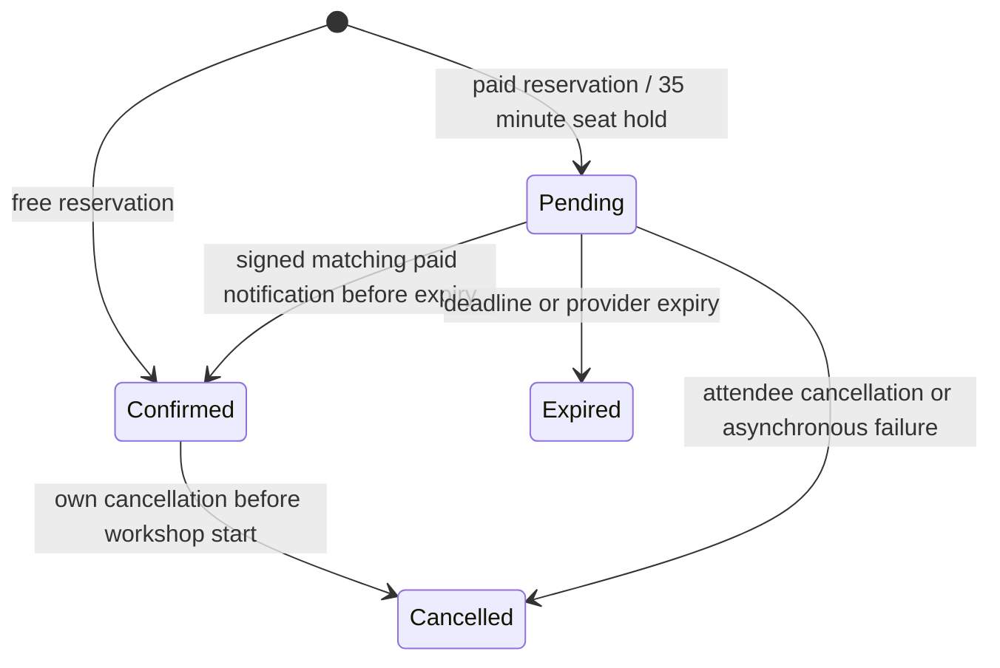

Cancellation is available only before workshop start; completed bookings show that deadline rather than an ineligible action. Every active booking consumes one seat. Reservation atomically increments only below capacity, then creates the booking in the same transaction; duplicates/failures roll back the counter. Cancellation/expiry conditionally transition once before decrementing. Capacity edits require reserved <= proposed capacity in the UPDATE. SQLite lock contention and PostgreSQL deadlock/serialization conflicts retry the entire operation within a bounded policy. Real independent connections verified final-seat, duplicate, cancellation, expiry, capacity-edit and payment races on PostgreSQL; no SQLite select_for_update guarantee is assumed.

Paid Checkout snapshots trusted GBP pence, uses stable idempotency and records the Session. Start within four minutes so Stripe's minimum remaining lifetime plus a safety margin fits the 35-minute hold. Redirects only display server state; raw signed, timestamp-validated, test-mode events with matching Session, amount, currency and reference grant payment. Duplicate receipts are no-ops. Unpaid/failed/expired events cannot grant resources. Late or mismatched success sets refund review without restoring a seat; the operator reconciles the test Dashboard and arranges any appropriate test refund manually. No live or automatic refunds are made.

Only an authorised owner/superuser or a relevant paid+confirmed attendee can download a private attachment. No public media route is registered. Cancellation, expiry or unpaid/unrelated identity revokes access. Reviews require confirmation, workshop end and explicit host-recorded attendance; trimmed bodies are 10–2000 characters, ratings 1–5, one own review per workshop. Superusers control visibility; editing a hidden review does not republish it.

## Release verification and assessment readiness

| Executed check, 19 October 2026 | Actual result / scope |
| --- | --- |
| Unchanged Phase 3 baseline | 110 passed before release changes |
| Actual SQLite full suite | 127 passed in 26.487s |
| Actual PostgreSQL 17.11 full suite | 127 passed in 35.306s; seven real connection races included |
| Private storage after real local database restart | Exact handout bytes retained, then probe removed |
| No-traffic expiry after restart | One expired hold released; capacity restored |
| Production configuration contracts | Explicit Heroku/PG/TLS/origin/proxy/storage rules pass |
| Authentication regressions | 19 account/throttle tests passed |
| Dependency audit | pip-audit 2.10.1: no known runtime vulnerabilities |
| Source/history and Markdown target checks | No unresolved findings; synthetic example classified; no history rewriting |
| GitHub Actions release jobs | Earlier Windows/PostgreSQL run [39280184246](https://github.com/AbdulkadirKhoujja/codeinstitute-milestone-4-project/actions/runs/39280184246) succeeded; latest-code run [39284481374](https://github.com/AbdulkadirKhoujja/codeinstitute-milestone-4-project/actions/runs/39284481374) queued at inspection |
| Heroku hosted release | Blocked — paid provisioning explicitly declined; empty separate app only |
| Formal learner-specific assessment confirmation | Not Verified — actual rubric/submission source unavailable |

The [requirements-to-evidence matrix](docs/assessment-audit.md) records Pass / Partial / Fail / Not Verified, implementation, evidence, gaps and remediations. It uses the user's actual requirements and available official context, not invented institutional criterion IDs. The public Code Institute course page confirms the four-project/Django course context but is not an assessment rubric. Submission readiness is **Not Verified** until the authoritative audit and mandatory hosted release are complete.

## Licensing status

No repository-wide licence has been granted. Public availability does not itself grant reuse rights. Django-generated boilerplate and third-party dependencies retain their own licences; the credits identify the official sources and tools. Choosing a licence remains the repository owner's decision and is not presented as an assessment pass.

The [Phase 4 checkpoint report](docs/phase-4-release-report.md) consolidates actual release results, the complete implementation-commit chronology and precise continuation steps. The substantive design, model, role, state and verification evidence remains presented directly above.
