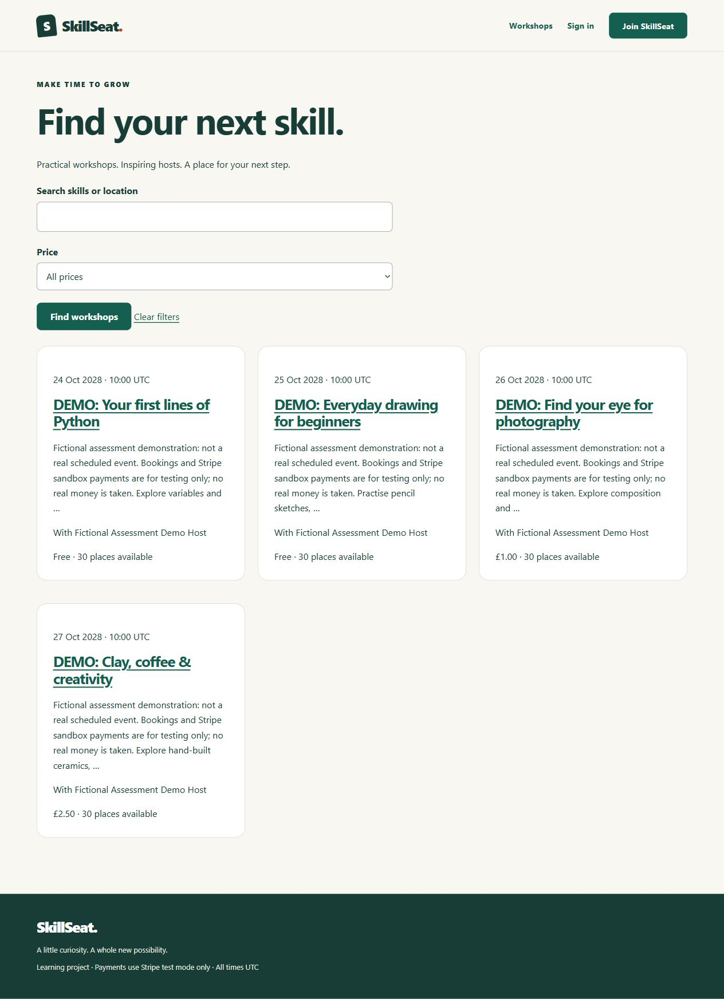

# Final review: permanent assessor catalogue

Verified 25 October 2026 against the existing SkillSeat Heroku app. The four completed development phases and their historical evidence are preserved.

## Production correction

The baseline had four users, one unpublished historical workshop, two bookings, two payment attempts and two webhook receipts. There were no published workshops and no resources. Every pre-existing row was compared with its saved baseline before and after this work; none changed.

A separate `seed_assessment --confirm skillseat-assessment-demo` command adds the permanent catalogue. The original development-only `seed_demo` production guard remains intact. The command requires explicit acknowledgement, a Stripe test key, signing-secret configuration and database-backed private storage. It serializes on a dedicated non-login demo owner, uses a transaction, preserves existing records and refuses conflicting identities/resource references. A real second production invocation changed no rows. It never creates successful payment records and never runs automatically on startup or release.

| Permanent fictional workshop | Price | Date, 10:00–12:00 UTC | Available after cleanup |
| --- | --- | --- | --- |
| DEMO: Your first lines of Python | Free | 24 October 2028 | 30/30 |
| DEMO: Everyday drawing for beginners | Free | 25 October 2028 | 30/30 |
| DEMO: Find your eye for photography | £1.00 sandbox | 26 October 2028 | 30/30 |
| DEMO: Clay, coffee & creativity | £2.50 sandbox | 27 October 2028 | 30/30 |

All four are published, identify themselves as fictional demonstrations rather than real scheduled events, and remain available after tester cleanup and an explicit restart of the existing web dyno. Photography includes a small private fictional practice handout stored in PostgreSQL.

## Actual hosted learner journeys

An ordinary new fictional learner was registered through the public HTTPS form, with no privileged permissions. Real CSRF-protected HTTP form submissions verified registration, login, logout, incorrect-password feedback, all four detail pages, anonymous and authenticated visibility, searches for Python/drawing/photography/clay, free/paid filtering, and the no-match message.

Free booking 34 became visibly Confirmed. A duplicate was rejected without creating a second reservation. Cancellation became visibly Cancelled and released the seat.

Paid booking 35 redirected to an actual Stripe sandbox Checkout for GBP 1.00. Anonymous downloads redirected to sign-in (302); authenticated unpaid downloads returned 404. Automatic browser approval review required the human user to submit the test card attempts. The user completed the decline and success steps; Stripe's real `payment_intent.payment_failed` event records `card_declined`/`generic_decline`, followed by a successful Checkout.

Stripe-origin event `evt_1UUMfDFWiMbptDb05jcLV90V` arrived at the hosted signed-webhook endpoint and created one durable receipt. The booking was confirmed with `paid=True`, its payment attempt succeeded, and My bookings displayed Confirmed / Payment verified. No test harness set a paid flag, created a success receipt or forwarded a success event. The learner downloaded the expected handout bytes with HTTP 200 and `Cache-Control: private, no-store`; SHA-256 `553f3491973ee032505cc9e68ffa052015f87d8b29fa28633693db6597315451`.

## Cleanup and final checks

The free cancelled booking was deleted. The paid test booking was cancelled through the public form, releasing its seat and revoking resource access (404). Its booking, successful attempt, webhook receipt and disabled fictional identity remain because their protected relationships preserve the audit. The temporary learner has an unusable password, no active login, no contact details and no remaining authenticated session. No active tester bookings remain. All four permanent workshops and the photography resource were preserved.

The existing web dyno was explicitly restarted. All four published listings reappeared with 30 places each; the database handout retained its exact bytes. The health endpoint returned 200, production deployment/security checks passed, and no error indicators appeared in the 155 recent log lines inspected. The baseline users/bookings/payment audit still matched exactly.

Regression history records genuine failing tests before implementation: five initial catalogue tests, then an additional failing resource-reference preservation test. All **143 Django tests**, including the six catalogue tests, pass locally; all **three custom JavaScript tests** pass. Ruff lint/format, migration consistency and whitespace checks pass. Windows and PostgreSQL 17/18 jobs passed for runtime commit `e0d3e556ecd8275b8920453978d2d54132866dac`: [CI run](https://github.com/AbdulkadirKhoujja/codeinstitute-milestone-4-project/actions/runs/40176234200). Windows CI also checks file-backed SQLite races; PostgreSQL jobs exercise actual Linux Gunicorn startup.

The final runtime implementation deployed successfully as **Heroku v26**. The final evidence/README publication contains the same runtime code; its exact delivery SHA/release is reported in the completion message, avoiding a self-referential commit hash in this document. [Machine-readable hosted evidence](testing/final-review-verification.json).

## Assessment instructions and limits

[How to Test SkillSeat](../README.md#how-to-test-skillseat) is near the beginning of the README. It documents the public learner flow, official Stripe cards, failed payments, protected downloads, cancellation and fictional-event notices. The existing Stripe sandbox displays AssetsCompliance™ branding; this is documented so the assessor can recognise Checkout.

Owner CRUD uses a separately administrator-provisioned private review account, arranged through the existing assessment channel. No privileged passwords are published. Paid cancellation retains manual refund review; the app does not automatically issue refunds. Test payment audit rows are deliberately retained with a disabled fictional learner rather than deleting financial history. There are no outstanding failures in the exercised assessor journeys. No additional infrastructure or services were provisioned.
