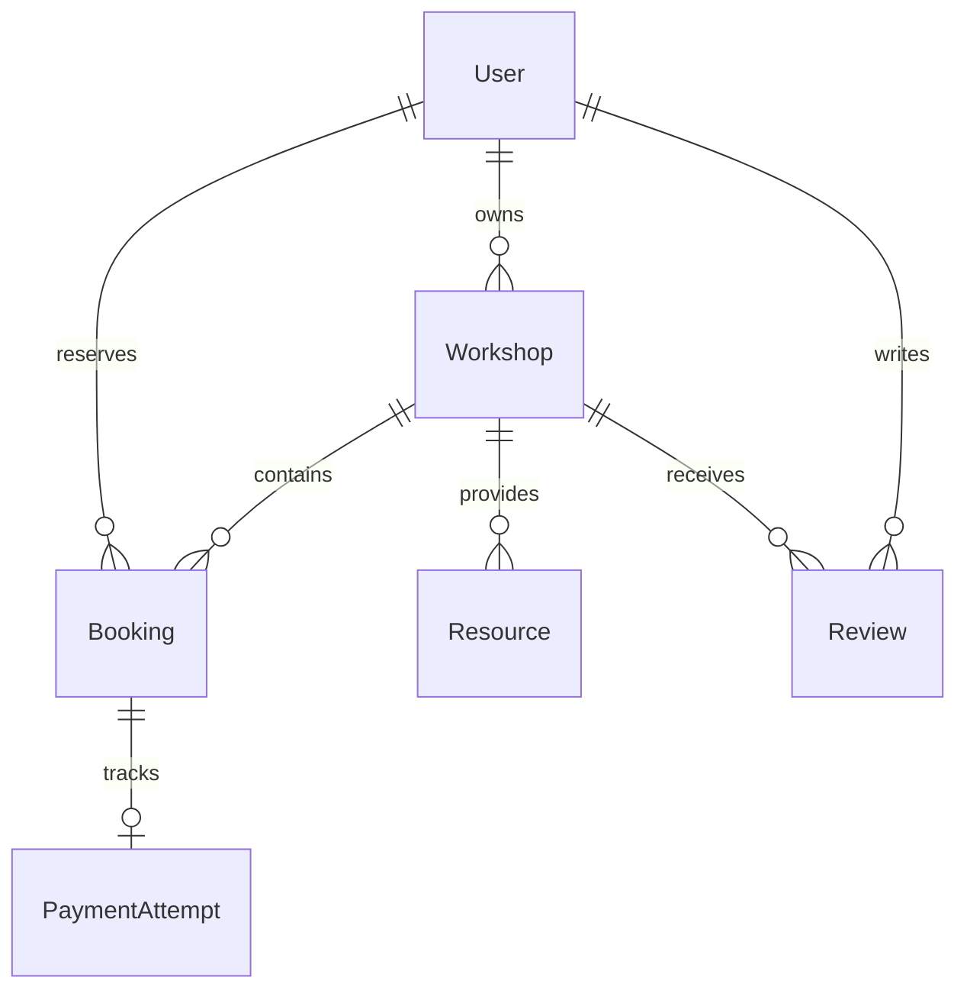
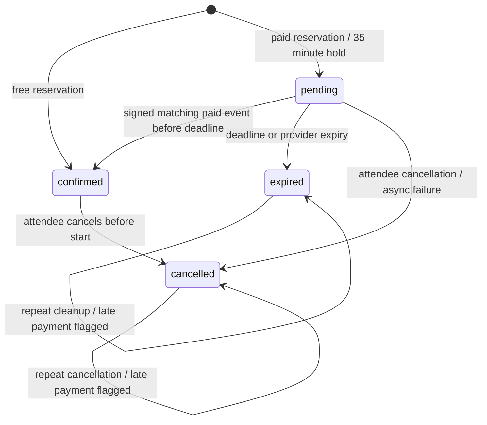

# Phase 3 architecture and operating policies

## Model relationships

`accounts.User` remains the Phase 2 AbstractUser. Foreign keys use AUTH_USER_MODEL. User deletion is protected for workshop owners, bookings and reviewers. Workshops with bookings cannot be deleted. Financial records are read-only in admin. PaymentEvent stores unique provider event identifiers and types without retaining personal payment payloads or credentials.

Workshop has a published flag, title, description, location, aware UTC start/end, integer capacity, reserved count and GBP price in integer pence. Database checks require positive capacity, reserved <= capacity, ordered dates and a free price of zero or paid price between 50 and 99,999,999 pence. The 50p minimum is an application policy. Positive integer database checks also prohibit negative counts and prices. Start and publication fields are indexed.

Booking stores attendee/workshop, amount snapshot, status, expiry, attendance, verified-paid and refund-review flags. A partial unique constraint allows at most one pending/confirmed booking per attendee/workshop while preserving cancelled and expired history. Database checks restrict states, require positive paid holds with expiry, and prevent a paid-price confirmation without verified paid state. Status/expiry has a combined cleanup index.

PaymentAttempt is one-to-one with Booking and has a unique nullable Checkout session ID, provider URL and state. PaymentEvent has a unique event ID for durable replay protection. Review has one row per attendee/workshop and a database rating check of 1–5. Resource stores a randomised internal filename in private local storage; `url()` is deliberately unavailable.

## Booking state machine

Every active booking consumes one place. Cancellation is available before the workshop starts; repeated cancellation is harmless. Paid cancellation releases the place and sets refund_required. Terminal bookings never reactivate: a new reservation creates a new row. Owner-recorded attendance does not change capacity. Full, unpublished and already-started workshops reject reservations on the server.

Reservation starts a transaction with `UPDATE workshop SET reserved = reserved + 1 WHERE published AND starts_at > now AND reserved < capacity`. Booking insertion and duplicate validation are in that transaction; any failure rolls back the counter. Database constraints backstop the counter and uniqueness. Cancellation/expiry update an eligible booking conditionally before decrementing its workshop counter, so only one caller releases a place. Owner capacity updates use a single conditional UPDATE requiring reserved <= proposed capacity.

SQLite select_for_update is not used. Transient SQLite lock contention retries whole operations up to eight times with short increasing delays, then returns a safe busy validation error. No external operation is retried without a stable provider idempotency key. Independent-connection tests cover shared-memory and file-backed SQLite. These results establish the tested local behaviour; they do not verify PostgreSQL. A production database must retain these constraints/conditional updates and run the same races, with database-specific deadlock/serialization handling reviewed before release. SQLite serializes writers and is not a high-throughput production design.

## Expiry is executable

Run `manage.py expire_bookings`. It is idempotent and releases expired pending holds. Reservation, discovery, detail and booking-list requests also run cleanup, so stale holds are cleared before availability is presented or reserved. There is no background scheduler configured. A quiet application needs an operator or deployment scheduler to run the command (for example every minute); Phase 4 must configure and verify that scheduler. A late webhook checks the actual deadline even if cleanup has not yet run.

## Stripe test-mode setup

1. Obtain a dedicated Stripe sandbox/test restricted key with Checkout permissions. Set it privately as STRIPE_TEST_KEY (`rk_test_` preferred; `sk_test_` supported). Live prefixes are refused.
2. Set PAYMENT_ORIGIN to the local origin, e.g. `http://127.0.0.1:8000`. Production configuration requires HTTPS. It is server configuration, never the request Host or a posted redirect.
3. Use the official CLI: `stripe listen --forward-to http://127.0.0.1:8000/workshops/payments/webhook/`. Export the listener's signing secret privately as STRIPE_WEBHOOK_SECRET and restart Django.
4. Subscribe to checkout.session.completed, checkout.session.async_payment_succeeded, checkout.session.async_payment_failed and checkout.session.expired. Use webhook API version `2026-09-30.endive`, matching pinned SDK 16.0.0.
5. Register an attendee, reserve a paid fictional workshop, start Checkout promptly, and use Stripe's documented test payment details. Verify a real provider session and signed event, the stored confirmation, resource access and replay behaviour. This end-to-end external exercise is still unverified in the current evidence.

Stripe credentials are not auto-loaded from `.env.example`. There is no publishable key needed because Checkout is fully hosted. Application pages never collect card details. No live financial operations are supported. The official CLI is optional development tooling in ignored `.local-tools`; it is not an application or CI dependency.

Checkout uses trusted amount/currency snapshots, a stable booking-specific idempotency key, a stable integration identifier and stored session identity. Owner price changes do not change an existing hold. Checkout expires at the booking's 35-minute deadline. Stripe requires at least 30 minutes remaining when creating a session, so initiation requires 31 minutes remaining; start within four minutes to allow that safety margin. Existing sessions may be reopened while the hold is active. If too little time remains, cancel/rebook. An API failure leaves the hold active until cancellation/expiry and returns a safe message; it never confirms payment.

Fulfillment is exclusively server-side, after the SDK validates the raw request signature and timestamp. The handler requires test-mode event/session flags, the stored session, payment mode, paid status, exact integer amount, GBP currency and matching reference. Returning from Checkout only shows current server state. Unpaid completed events await a distinct async success. Replayed events are no-ops. Failed/expired events release pending holds and cannot downgrade verified confirmations. Different events serialize on the booking before reading state. An unknown session rolls back the receipt so delivery can be retried.

Late success after cancellation/expiry, or a mismatched paid amount/reference/currency, sets administrative refund review. It cannot restore capacity or grant resources. The operator must compare PaymentAttempt/Booking with the Stripe test Dashboard, arrange the appropriate test refund there, and retain the flag as an audit signal. No automatic refund, live charge, reconciliation scheduler or claim of money returned is made. Cancelled Checkout redirects do not cancel a booking by themselves; use Cancel booking or wait for expiry. The dashboard message explains pending and refund-review states.

## Roles, routes and boundaries

Registration creates an ordinary attendee with no staff flag, group or owner permission. A trusted administrator grants `workshops.add_workshop` to an approved owner through Django admin, directly or through a controlled group. Do not grant general user/permission administration to workshop owners. Revoking the permission removes studio/resource-management access. Superusers explicitly manage all workshops and moderate reviews. Ordinary staff status alone does not confer studio access.

| Route | Access / purpose |
| --- | --- |
| `/`, `/workshops/`, `/workshops/<id>/` | Public home/upcoming discovery/published detail (past details retain reviews, booking closed) |
| `/accounts/register/`, `/accounts/login/` | Public validated registration and authentication |
| `/accounts/`, `/accounts/edit/`, `/accounts/password/` | Own authenticated account only |
| `/accounts/logout/` | POST-only logout |
| `/workshops/<id>/book/` | Authenticated POST, trusted price/capacity |
| `/workshops/bookings/` | Own booking history and server payment state |
| `/workshops/bookings/<id>/cancel/`, `.../checkout/` | Own booking, POST-only |
| `/workshops/studio/`, `.../new/`, `.../<id>/` | Owner permission; own rows, superusers across rows |
| `/workshops/studio/<id>/resources/` | Authorised owner upload, POST-only |
| `/workshops/studio/bookings/<id>/attend/` | Authorised owner, confirmed booking after end, POST-only |
| `/workshops/resources/<id>/` | Authorised owner/superuser or relevant verified-paid confirmed attendee |
| `/workshops/resources/<id>/delete/` | Authorised owner, POST-only |
| `/workshops/<id>/review/` | Own eligible review creation/editing |
| `/workshops/reviews/<id>/delete/` | Own review deletion, POST-only |
| `/workshops/payments/webhook/` | POST-only signature-authenticated provider endpoint; sole CSRF exemption |
| `/admin/` | Django staff boundary; financial audit/review moderation require superuser |

Ownership fields are excluded from forms and assigned server-side. Protected queries scope object lookup before action; missing/foreign objects fail safely. Private pages use no-store, templates escape user content, state changes require CSRF except signed webhooks, and login return URLs retain Django's safe-host checks. A restrictive self-only CSP is applied to application pages; Django admin retains its built-in assets/policy behaviour. No new proxy trust or weakened production settings were introduced.

## Private resources

Owners upload up to 5 MB per file. Files live under ignored private-resources, outside public static files. No media URL is registered. Downloads look up Resource by integer ID, verify ownership/paid confirmed booking, and use FileResponse as an octet-stream attachment with private/no-store. Random names prevent filename collisions; posted paths never select files. Cancellation/expiry/unpaid/unrelated/anonymous requests cannot download. Free bookings deliberately do not satisfy the committed paid-resource story.

Production must keep this storage outside the web root, enforce request-size limits at the proxy, review content scanning/quotas, and replace local streaming with private object storage or an authorised internal redirect if needed. Never map the private directory to a public media location. Availability of the local file and production delivery infrastructure remain operational responsibilities.

## Reviews and moderation

Eligibility requires an authenticated attendee, a confirmed booking, workshop end in the past and explicit host-recorded attendance. Paid workshops therefore also require verified payment. Booking alone never permits an early review. The form restricts ratings to 1–5 and trimmed bodies to 10–2000 characters; ownership/visibility fields are excluded. A reviewer creates or edits only their own row and may delete their own review. Published detail pages show visible reviews, with escaped text and public username. Superusers hide/reinstate or delete reviews in admin; editing a hidden review does not republish it. No owner can moderate another person's review through the studio.

## Acceptance evidence map

| Committed README story | Implementation | Automated evidence |
| --- | --- | --- |
| Public discovery | Workshop listing/detail, published filtering | test_workshops.DiscoveryTests |
| Register/use account | Django forms, own-profile edit, password change | test_account_management; original test_accounts |
| Book within capacity | reserve transaction and database constraints | test_booking; test_concurrency |
| Cancel own booking | conditional terminal transition and seat release | test_booking; test_concurrency |
| Verified test-mode payment | StripeClient Checkout, raw signature validation and durable event receipts | test_payments; test_regressions.PaymentFailureTests; payment races; external test transaction pending |
| Paid resources | private storage and authorised FileResponse | test_resources_reviews |
| Eligible reviews | ended + confirmed + attended, ownership and moderation | test_resources_reviews; test_regressions |
| Owner listings | controlled permission, scoped studio, conditional capacity edits | test_ownership; test_concurrency |
| Related owner/admin workflows | roster, attendance, upload/delete, audit and moderation admin | test_resources_reviews; test_ownership |
| Role/data boundaries | CSRF, POST methods, XSS escaping, scoped queries and server prices | original security/account tests; test_regressions; test_payments |

Browser and responsive observations are recorded separately in [design verification](design/phase-3-verification.md). Tests simulate provider events and initiation; they do not substitute for the unavailable genuine Stripe sandbox verification.
